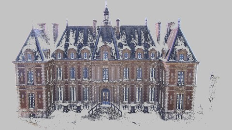

**********************************
Export to Colmap
**********************************

OpenMVG exports to Colmap's [Schoeneberger2016]_ SfM model format.

Once a sparse reconstruction has been computed you can convert OpenMVG's SfM output to Colmap's model format using openMVG_main_openMVG2Colmap:

.. code-block:: c++

  $ openMVG_main_openMVG2Colmap -i Dataset/OpenMVGSfM/sfm_data.bin -o Dataset/ColmapSfM/model

This will create the following files in ``Dataset/ColmapSfM/model``:

.. code-block:: text

    model/
    ├-cameras.txt
    ├-images.txt
    ├-points3D.txt

Options:

- ``-f|--format txt|bin|both``: write the text files (default), COLMAP's binary files (``cameras.bin``, ``images.bin``, ``points3D.bin``), or both. Binary files are smaller and faster to load for large scenes.
- ``-n|--no_color``: do not read the images; points are written in gray.
- ``-p|--precision``: significant digits of floating-point values in the text files (default 17, which reads back exactly).

The model is exact: pixel coordinates are converted to COLMAP's convention (OpenMVG puts pixel (0,0) at the centre of the top-left pixel, COLMAP at its top-left corner, so principal points and 2D observations are shifted by +0.5), and each OpenMVG camera model is mapped to the COLMAP model with identical formulas:

==================== ==================================================================
OpenMVG              COLMAP
==================== ==================================================================
pinhole              PINHOLE (fx = fy = f)
pinhole_radial_k1    SIMPLE_RADIAL
pinhole_radial_k3    FULL_OPENCV (k1 k2 k3, other coefficients 0)
pinhole_brown_t2     FULL_OPENCV (k1 k2 k3, p1 = t1, p2 = t2)
fisheye              OPENCV_FISHEYE
==================== ==================================================================

Views with another camera model (e.g. spherical) or without a pose are not exported. The images are read to color the points; a relative ``root_path`` is resolved against the directory of the sfm_data file. Points whose images cannot be read are written in gray.

To open the scene in Colmap:

- File | Import model
- Specify the ``Dataset/ColmapSfM/model`` directory

To apply Colmap's MVS pipeline:

.. code-block:: c++

  $ colmap image_undistorter --image_path Dataset/images --input_path Dataset/ColmapSfM/model --output_path Dataset/ColmapMVS
  $ colmap dense_stereo --workspace_path Dataset/ColmapMVS
  $ colmap dense_fuser --workspace_path Dataset/ColmapMVS

   Figure: Multiple View Stereo result using [Schoeneberger2016]_.
